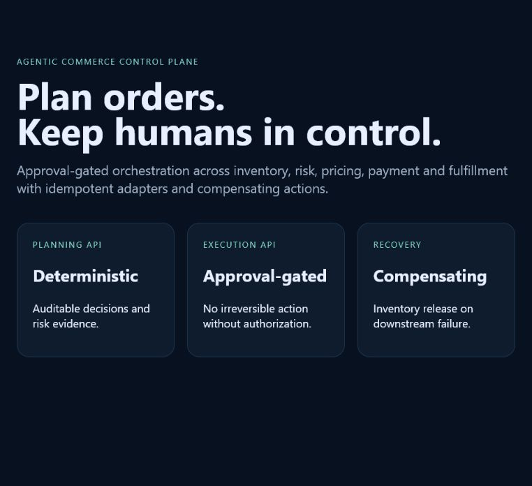

# CommercePilot AI

[](https://github.com/thillainirmal-tech/CommercePilot-AI/actions/workflows/ci.yml)

## Product tour



[Open the full-resolution screenshot](docs/media/product-console.jpg) · **Recruiter demo:** create an auditable order plan, show the approval boundary, then explain idempotent execution and inventory compensation on downstream failure.

[▶ Watch the recorded planning demo (5 seconds)](docs/media/runtime-demo.mp4)

> **Deployment status:** tested, containerized and ready for an AWS deployment; execution requires configured downstream services and no public production endpoint is claimed yet.

An explainable, safety-first agentic commerce orchestrator. Inventory, risk, pricing and fulfillment agents produce an auditable order plan; an independent approval-gated endpoint can execute it through real service adapters.

## Why it stands out

- Deterministic multi-agent trace with evidence for every decision
- Human review for high-risk orders
- Inventory and pricing rules with reproducible behavior
- Authenticated, idempotent inventory, payment and shipment adapters with inventory compensation on downstream failure
- Browser dashboard, validation, Actuator health, tests, CI and Docker

## Run

```bash
mvn spring-boot:run
```

Planning works without downstream writes. Execution requires `INVENTORY_SERVICE_URL`, `PAYMENT_SERVICE_URL`, `FULFILLMENT_SERVICE_URL`, `COMMERCE_SERVICE_TOKEN`, and `COMMERCE_APPROVAL_TOKEN`; missing adapters fail explicitly.

## Verify

```bash
mvn verify
docker build -t commercepilot-ai .
```

## Architecture

`Order request → inventory agent → risk agent → pricing agent → fulfillment plan → approval boundary`

`POST /api/orders/execute` accepts the same validated order plus `X-Approval-Token`. It executes only an approved deterministic plan, sends an idempotency key to every adapter, and releases inventory if payment or fulfillment fails.

## License

MIT
